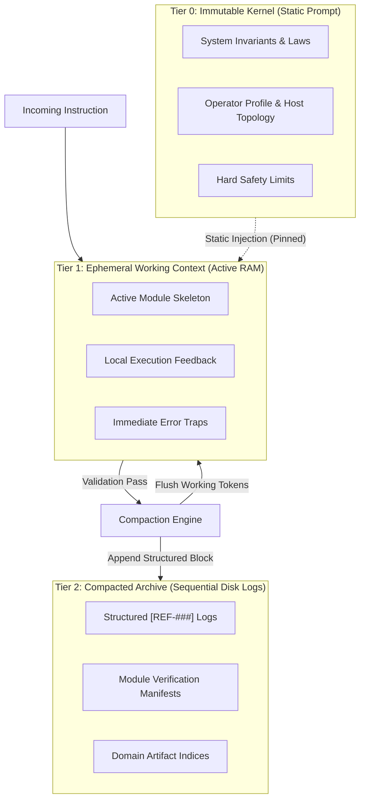
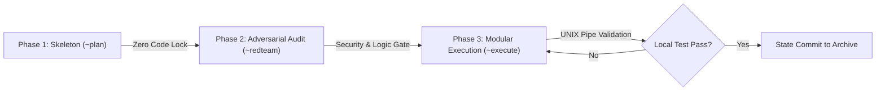
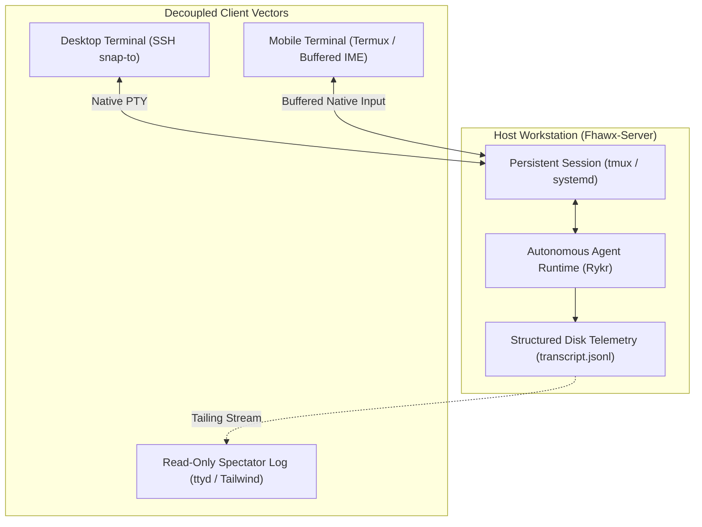

# Architectural RFC: Hardened Systems Engineering Patterns for 24/7 Autonomous Agent Stability on Consumer Hardware

**Author:** Bill Fullen (`tethtibis`) — Systems & Network Engineer  
**Date:** October 2026  
**Status:** Request for Comments (RFC) / Technical White Paper  
**Target Domain:** Local AI Agent Harnesses (Odysseus, Ajax, Local AutoGen, Sub-14B Autonomous Daemons)

---

## 1. The Core Philosophy: Control-Plane Dampening vs. Reinventing the Wheel

> [!IMPORTANT]
> **The Foundational Premise:** When local autonomous agents fail, the software community's default reflex is to write more code—spinning up complex 10,000-line Python frameworks, chaining prompt abstractions, or attempting costly model re-training. 
> 
> **This is the engineering mistake of redesigning the wheel when the vehicle simply lacks a suspension system.**

In physical systems engineering, you do not fix a vibrating chassis by carving a new shape of tire from raw rubber. You install shock absorbers to dampen road entropy, establish a rigid chassis, and align the drivetrain.

In autonomous agent orchestration on consumer hardware:
* **The LLM is the wheel:** It is a probabilistic rotational engine. It works.
* **The OS utilities are the road:** Bash, Python, file systems, and network sockets are standard physical surfaces.
* **The Breakdown is Mechanical Vibration (Entropy):** Because LLMs are probabilistic, every unconstrained turn introduces entropy. Without dampening, that vibration compounds across turns until the context window rattles itself to death (context rot, runaway loops, and syntax collapse).

Our architecture **does not reinvent the model, nor does it write heavy code abstractions**. It treats the model and OS tools as static black-box components and modulates **how the system's linear event line operates**. By treating agent execution as an assembly line with strict state dampers (input/output boundaries, state locks, and tiered memory flushes), we absorb probabilistic entropy before it can shatter the runtime.

---

## 2. Problem Statement: The Reality of Sub-14B Local Agents

Frontier SaaS models (Claude 3.5 Sonnet, Gemini 1.5/2.0 Pro) mask systemic architectural flaws behind massive 200k–2M token context windows. Developers migrating to local agents running on consumer hardware (e.g., 7B–14B parameter models like **Qwen 2.5 9B / Ajax**) immediately hit hardware ceilings:
1. **Constrained Context Buffers:** Functional context windows are effectively limited to 8k–16k tokens before GPU VRAM exhaustion or catastrophic attention decay occurs.
2. **Context Rot & Drift:** As conversation histories grow past 8–10 turns, small parameter models suffer from attention entropy—repeating loops, hallucinating non-existent paths, and dropping operational constraints.
3. **Fragile Tool-Calling Syntaxes:** Rigid JSON function-calling frameworks frequently fail on sub-14B models due to syntax escaping errors, nested array parsing bugs, and "ghost tool calls."
4. **Lifecycle Coupling:** Naive agent wrappers that tightly bind the agent runtime to HTTP web sockets or client connections crash or cascade `SIGKILL` to background tasks upon client disconnection.

This RFC outlines four battle-tested systems engineering patterns engineered and validated across 179+ continuous operational milestones on consumer Linux workstations.

---

## 3. Pattern 1: The 3-Tier Hierarchical Memory Bus (Mitigating Context Rot)

### The Failure of Naive Chat History & Raw Vector RAG
In most open-source agent implementations, developers either:
* **Append Unbounded Chat Logs:** Rapidly exhausting `n_ctx` and causing OOM crashes or attention decay.
* **FIFO Truncation:** Dropping early tokens, leading to amnesia regarding system invariants and safety boundaries.
* **Indiscriminate Vector RAG:** Embedding every turn into ChromaDB/FAISS. For sub-14B models, semantic vector similarity retrieval introduces high noise—retrieving irrelevant historic turns that pollute the working prompt.

### The Solution: Deterministic Tiered Bus
We isolate memory into three discrete tiers with explicit eviction and compaction protocols:



### Protocol Specifications
1. **Tier 0 (The Kernel - Invariant):** 
   * Pinned statically at the head of every context injection.
   * Contains immutable system rules, behavioral invariants, and host hardware topologies.
   * **Never evicted, never modified by LLM inference.**
2. **Tier 1 (Working Memory - Ephemeral):**
   * Contains *only* the active module's inputs, outputs, and direct execution telemetry.
   * Sized strictly under 4,000 tokens.
   * Upon successful local validation of the active module, a **State Purge (`[MEM_COMMIT]`)** is triggered.
3. **Tier 2 (The Archive - Cold Storage):**
   * High-density, human-readable structured logs (`[REF-###]`) committed directly to disk.
   * Format: `[REF-ID] | Timestamp | Domain | Dense Factual Outcome`.
   * When historical context is required, the agent queries specific reference keys or index headers sequentially, bypassing fuzzy vector hallucination.

> [!IMPORTANT]
> **Key Metric:** Over 179 distinct project milestones, the working context window remained below 25,000 tokens total, with zero degradation in system identity or loss of core architectural rules.

---

## 4. Pattern 2: The Constrained 3-Stage State Machine (The Genesis Pipeline)

### The Single-Shot Failure Mode
When a sub-14B model is asked to complete a complex objective in a single prompt (*"Write a daemon to monitor network interfaces and push alerts to Discord"*), it attempts generative leaps:
* Fabricating package names and API endpoints.
* Mixing logic definition with implementation debugging.
* Getting trapped in recursive "fix-the-syntax" loops.

### The Solution: The 3-Phase State Lock (The Dampening System)



### Phase Rules
* **Phase 1: Skeleton & Map (`~plan`)**
  * **Constraint:** ZERO code generation allowed.
  * **Action:** Model must strictly output a high-level logical skeleton, mapping data flow and explicitly defining strict inputs and outputs for each isolated module.
  * **State Lock:** Runtime blocks any tool execution until the plan is verified.
* **Phase 2: Adversarial Audit (`~redteam`)**
  * **Constraint:** Model must adopt an adversarial posture against its own Phase 1 skeleton.
  * **Action:** Actively hunt for logic flaws, security vulnerabilities, edge-case network partitions, and resource ceilings.
  * **State Lock:** Flaws must be neutralized before unlocking code execution.
* **Phase 3: Modular Single-Threaded Execution (`~execute`)**
  * **Constraint:** Strict UNIX pipe (`|`) modularity. Build exactly ONE isolated module at a time.
  * **Anti-Creep Failsafe:** All lateral ideas or feature additions introduced during execution are banned from the active prompt and redirected to a `backlog.md` file.

---

## 5. Pattern 3: Delimited Tag Invocation vs. Rigid JSON Schemas

### The JSON Schema Breakdown on Sub-14B Models
Standard OpenAI-style JSON function calling mandates schemas like:
```json
{"tool": "run_command", "parameters": {"command": "echo 'hello' && awk '{print $1}'"}}
```
On 7B–9B parameter models, this creates severe failure vectors:
* **Escaping Collisions:** Bash commands containing quotes, slashes, or regex frequently shatter JSON serialization.
* **Ghost Tool Calls:** Models output JSON text into the chat stream instead of triggering the parser, or converse when they should execute.
* **Token Overhead:** JSON schema definitions consume substantial prompt token space on every turn.

### The Solution: Delimited Boundary Interception
In our empirical testing on local models (Qwen 2.5 3B/14B on Nvidia Pascal/Ampere GPUs), replacing JSON schemas with **XML-bounded syntax** reduced tool parsing failures to nearly zero:

```xml
<tool_invoke name="run_command">
<arg name="command">
python3 -c "import os; print(os.listdir('/var/log'))"
</arg>
</tool_invoke>
```

#### Why it Works:
1. **Tokenizer Native Delimiters:** Transformer BPE tokenizers handle structural opening/closing tokens (`<tag>`, `</tag>`) with extreme attention salience compared to subtle punctuation commas or curly braces.
2. **Multi-line Immunity:** Shell scripts and Python code blocks can be passed raw between tags without escape-character corruption.
3. **Stream Interception:** The host harness can use standard regex (`<tool_invoke.*?>.*?</tool_invoke>`, `re.DOTALL`) to intercept and execute tools mid-stream without waiting for full JSON payload validation.

---

## 6. Pattern 4: Decoupled Lifecycle Architecture (Persistent OS Process)

### The Fragile Subprocess Trap
Early iterations of our framework attempted to wrap the agent in an asynchronous web server (`FastAPI`/`Node.js`) running headless CLI subprocesses. 

**Observed Empirical Failures:**
* Mobile WebSocket drops or network switches triggered OS signal cascades, issuing `SIGKILL` to active agent child processes.
* Long-running compilations or multi-tool reasoning chains hit HTTP 30-second gateway timeouts.
* Complex web UI frontends created synchronization lag and amnesic clone collisions.

### The Production Standard: The Headless Detached Session
We permanently resolved lifecycle fragility by structurally decoupling the **Agent Runtime** from the **I/O Client**:



1. **Host Native Residency:** The agent runs inside a persistent `tmux` session managed by systemd on the host machine.
2. **Zero-Friction Snap-To Wrapper:** Connecting clients execute an intelligent wrapper:
   ```bash
   # Attach to active session, forcefully detaching any dead ghost connections
   tmux attach-session -d -t rykr || tmux new-session -s rykr
   ```
3. **Telemetry via Structured Logs:** The UI/viewer layer never manages agent state. It merely tails the local JSONL execution transcript (`transcript.jsonl`) generated natively by the agent runtime on disk.

---

## 7. Empirical Validation & Real-World Results

The architectural patterns detailed in this RFC were not tested in synthetic benchmark sandboxes; they were engineered and hardened across months of real-world operational sysadmin tasks on consumer hardware:

* **Sustained Operational Longevity:** Over 179 sequential milestones executed without a single loss of foundational kernel identity or system invariants.
* **Thermal & Hardware Isolation:** Multi-node orchestration successfully offloaded heavy compilation to GPU worker nodes while maintaining conductor orchestration on low-power Intel N95/N150 CPUs.
* **Zero SaaS Dependencies:** The entire orchestration pipeline runs 100% locally on standard Linux hosts without external API gateways, vector database subscriptions, or proprietary harness lock-in.

---

## 8. Recommendations for the Odysseus & Ajax Projects

For Felix (`PewDiePie`) and the Odysseus/Ajax open-source developer core, adopting these patterns provides an immediate roadmap to eliminate local agent fragility:

1. **Stop Writing Boilerplate to Fix Model Flaws; Regulate the Pipeline:** Do not attempt to fix Qwen 2.5 9B by writing complex python wrappers. Implement strict state-gated pipelines in Odysseus: forbid Ajax from generating multi-file code directly, forcing it through Skeleton $\rightarrow$ Audit $\rightarrow$ Execution.
2. **Adopt Delimited XML Tool Invocations for Ajax:** Deprecate complex JSON function schemas. Fine-tune or system-prompt Ajax to emit `<tool_invoke>` tags with regex interception in the Odysseus backend.
3. **Structure Odysseus Memory as a 3-Tier Bus:** Stop relying purely on raw conversational context. Pin immutable system rules in T0, enforce working memory flushes in T1, and serialize completed tasks into structured T2 plain-text archives.

---

## 9. Author Contact & Collaboration

This RFC is submitted to foster open, decentralized, and sovereign AI tooling. I welcome technical discussion, adversarial critique, and collaborative implementation testing:

* **Author:** Bill Fullen (`tethtibis`)
* **Role:** Systems & Network Engineer / Local AI Orchestration Researcher
* **Location:** Fhawx Network Domain
* **Contact:** Direct correspondence via GitHub (`tethtibis`) or community forums.
